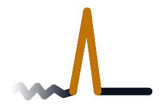
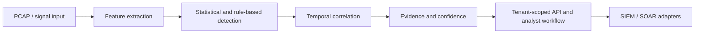

<p align="center">
   
</p>

<h1 align="center">ThreatFade</h1>
<p align="center"><strong>Evidence-first detection and investigation for security teams monitoring adversarial activity that deliberately fades from view.</strong></p>
<p align="center">
  <a href="https://github.com/LloydCoder/tinlance-threatfade/actions/workflows/ci.yml"></a>
  <a href="https://github.com/LloydCoder/tinlance-threatfade/actions/workflows/security.yml"></a>
  <a href="https://github.com/LloydCoder/tinlance-threatfade/releases"></a>
</p>

## At a glance

ThreatFade looks for meaningful reductions or changes in observable network and signal activity, including command-and-control (C2) quieting, gradual living-off-the-land (LOTL) activity changes and GNSS interference. It combines statistical signal analysis, detection rules, temporal correlation and structured evidence to support analyst investigation.



> [!NOTE]
> This is an architecture view, not a hosted product demonstration. A current dashboard screenshot or short demo recording has not yet been supplied for this repository; no fabricated demo is presented.

## Why ThreatFade

| Problem | Approach | Evidence boundary |
|---|---|---|
| Adversary activity becomes quieter or less observable | Rolling entropy, statistical deviation and detection rules | Synthetic regression is not external detection validation |
| Signals span multiple domains | Reusable temporal correlation and detection packs | Temporal association is not causal attribution |
| Analysts need explainable outcomes | Structured evidence, confidence context and ATT&CK mapping | ATT&CK mapping does not establish attribution |
| Sensors may lose control-plane connectivity | Bounded store-and-forward and signed replay-safe batches | Operational limits depend on deployment configuration |
| Enterprise teams need controlled access | OIDC/JWT, RBAC, tenant-scoped resources and audit events | A live IdP/database and independent review remain deployment work |

ThreatFade is an evidence-first detection and investigation platform. It is not a general-purpose EDR replacement, a guarantee of threat prevention, or a substitute for a customer's SOC processes.

## Quick start

The following starts the local development API and dashboard. The first dependency installation may take longer than 30 seconds.

```bash
git clone https://github.com/LloydCoder/tinlance-threatfade.git
cd tinlance-threatfade
python -m venv .venv && source .venv/bin/activate
python -m pip install -r requirements.txt
python api.py
```

Open [http://localhost:8080](http://localhost:8080). API documentation: [http://localhost:8080/docs](http://localhost:8080/docs).

Verify the service:

```bash
curl --fail http://localhost:8080/health
curl --fail http://localhost:8080/ready
curl --fail http://localhost:8080/version
```

> [!WARNING]
> This is a local development setup. Do not expose it to the public internet. Production mode requires a configured identity provider, database, TLS/edge controls, secret injection and deployment hardening. See [Secure deployment](docs/SECURE_DEPLOYMENT.md).

## Installation

### Prerequisites

| Requirement | Purpose |
|---|---|
| Python 3.11 or 3.12 | Supported CI/test matrix |
| pip and Git | Dependency installation and source checkout |
| Linux/macOS/Windows | Local development; live capture has platform-specific requirements |
| Docker Engine and Compose plugin | Container deployment |
| PostgreSQL 16-compatible service | Production persistence |

The container build currently uses Python 3.14.10 on Debian Trixie. The local CI test matrix uses Python 3.11 and 3.12. Optional sensor/native dependencies may behave differently across operating systems.

### Windows PowerShell

```powershell
git clone https://github.com/LloydCoder/tinlance-threatfade.git
Set-Location tinlance-threatfade
py -m venv .venv
.\.venv\Scripts\Activate.ps1
python -m pip install -r requirements.txt
python api.py
```

### Docker Compose

The production Compose file is a hardened reference deployment, not a zero-configuration demo. It requires PostgreSQL and application database credentials, OIDC issuer and audience, allowed origins, and an existing external Docker network named `threatfade_proxy`. Supply values through a secret manager or ignored local environment file; never commit populated secrets.

Review [Secure deployment](docs/SECURE_DEPLOYMENT.md) and [Configuration reference](docs/reference/configuration.md) before using Compose.

## Usage

### Dashboard and API

After `python api.py` starts:

- Dashboard: `http://localhost:8080/`
- OpenAPI UI: `http://localhost:8080/docs`
- Health: `GET /health`
- Readiness: `GET /ready`
- Version: `GET /version`

### Run a scenario through the API

The local development authentication behavior is intentionally different from production. Use a local test environment; do not treat this as a production credential pattern.

```bash
curl --fail-with-body \
  -H 'Content-Type: application/json' \
  -X POST http://localhost:8080/detect/scenario \
  -d '{"scenario":"c2_quieting","use_ml":false}'
```

Supported scenario names: `c2_quieting`, `lotl_gradual`, `gnss_jam`, `normal_with_fade`, `mixed`.

### Run the command-line simulator

```bash
python main.py --scenario c2_quieting
```

Optional arguments include `--data`, `--export`, `--live`, `--duration` and `--use-ml`. Live capture requires appropriate permissions and platform dependencies. See the [sensor runtime guide](docs/SENSOR_RUNTIME.md).

### Run tests

```bash
python -m pytest -q
```

CI additionally runs architecture validators, PostgreSQL migration checks, benchmarks, integration checks and supply-chain gates. See [CI workflow](.github/workflows/ci.yml).

## Configuration

The baseline is in `config.yaml`; deployment-specific behavior is controlled by environment variables. This table lists values verified in the current source and Compose configuration, not every optional integration variable.

| Setting | Default / requirement | Purpose |
|---|---|---|
| `THREATFADE_ENV` | `development` | Runtime environment |
| `THREATFADE_ALLOWED_ORIGINS` | `http://localhost:8080` | Comma-separated CORS origins |
| `THREATFADE_MAX_BODY_BYTES` | `2097152` | API request body limit |
| `THREATFADE_MAX_PCAP_BYTES` | `104857600` in example | Maximum PCAP upload bytes |
| `THREATFADE_MAX_PCAP_PACKETS` | `1000000` in example | Maximum PCAP packet count |
| `THREATFADE_PCAP_TIMEOUT_SECONDS` | `30` in example | PCAP processing timeout |
| `THREATFADE_PCAP_MAX_MEMORY_MB` | `512` in example | PCAP processing memory bound |
| `THREATFADE_RATE_LIMIT` | `120` in example | Request rate limit |
| `THREATFADE_RATE_WINDOW_SECONDS` | `60` in example | Rate-limit window |
| `THREATFADE_OIDC_ISSUER` | Required in production Compose | OIDC issuer |
| `THREATFADE_OIDC_AUDIENCE` | Required in production Compose | Expected token audience |
| `THREATFADE_OIDC_JWKS_URL` | Optional in Compose | Signing-key discovery endpoint |
| `THREATFADE_DATABASE_URL` | Required by production Compose | SQLAlchemy database URL |
| `POSTGRES_PASSWORD` | Required by Compose | PostgreSQL bootstrap password |
| `THREATFADE_APP_DB_USER` | Required by Compose | Application database user |
| `THREATFADE_APP_DB_PASSWORD` | Required by Compose | Application database password |

See [Configuration reference](docs/reference/configuration.md) and [`.env.example`](.env.example). Blank example values are placeholders, not usable credentials.

## Features

| Area | Capability | Qualification |
|---|---|---|
| Signal analysis | PCAP/PCAPNG ingestion, rolling entropy, z-score analysis | Implemented and tested |
| Detection | C2 quieting, LOTL gradual fade, GNSS interference scenarios | Synthetic regression coverage |
| Correlation | Multi-domain temporal correlation | Implemented; association is not causation |
| Evidence | Structured evidence, confidence context and signed offline packages | Implemented and tested |
| Analyst workflow | Tenant-scoped inbox, investigations and dispositions | Implemented and tested |
| Identity | OIDC/JWT, RBAC, tenant isolation and session controls | Repository-tested; live IdP configuration is external |
| Integrations | Elastic, Sentinel, QRadar, Graylog, Wazuh, MISP, OpenCTI, TheHive and SOAR adapters | Contract-tested; live receiver validation is deployment-specific |
| Operations | Docker, Kubernetes, health/readiness, observability and recovery tooling | Reference assets and automated validation |
| Experimental ML | Isolation Forest comparator | Experimental; not authoritative for production detection |

## Documentation

Start with the [documentation index](docs/README.md).

| Need | Documentation |
|---|---|
| Architecture and trust boundaries | [Security architecture](docs/SECURITY_ARCHITECTURE.md), [threat model](docs/THREAT_MODEL.md) |
| Secure deployment | [Secure deployment](docs/SECURE_DEPLOYMENT.md) |
| Configuration | [Configuration reference](docs/reference/configuration.md) |
| Detection methodology | [Detection evaluation](docs/DETECTION_EVALUATION.md) |
| Enterprise integrations | [Enterprise integrations](docs/ENTERPRISE_INTEGRATIONS.md) |
| Sensor deployment | [Sensor runtime](docs/SENSOR_RUNTIME.md) |
| Disaster recovery | [Disaster recovery](docs/DISASTER_RECOVERY.md) |
| Performance methodology | [Benchmark guide](benchmarks/README.md) |
| Build and assurance status | [Build status](docs/BUILD_STATUS.md), [independent assurance package](docs/evaluation/INDEPENDENT_VALIDATION_PACKAGE.md) |
| Brand identity | [Brand asset guide](brand/README.md) |

## Contributing

Contributions are welcome. Read [CONTRIBUTING.md](CONTRIBUTING.md), use the issue and pull-request templates, add regression tests for behavior changes, and never include secrets or customer evidence in public submissions.

## License and acknowledgements

The source files in this repository are licensed under the [Apache License 2.0](LICENSE), unless a file or third-party component states otherwise. The repository describes an open-core product; separately distributed proprietary services or extensions are not automatically licensed by this repository's LICENSE file.

ThreatFade is developed by Tinlance Limited. The project uses open-source libraries and tools declared in [requirements.txt](requirements.txt) and its container/build workflows. Refer to upstream projects for their respective licenses and attribution requirements.

## Support

For usage questions and non-sensitive troubleshooting, see [SUPPORT.md](SUPPORT.md). Report suspected vulnerabilities privately using [SECURITY.md](SECURITY.md); do not post exploit details or sensitive evidence in public issues.

<details>
<summary>Roadmap and assurance boundaries</summary>

The next major assurance milestone is independent execution of the frozen evaluation and penetration-test packages, followed by controlled field validation. Repository CI is not a substitute for independent detection validation, penetration testing, customer-scale field measurements or formal certification.

See [Build status](docs/BUILD_STATUS.md) and [Phase 20 assurance preparation](docs/PHASE_20_INDEPENDENT_ASSURANCE.md).

</details>

<details>
<summary>Troubleshooting</summary>

- If the API cannot start, verify the virtual environment and install dependencies from `requirements.txt`.
- If PostgreSQL is unavailable, use the documented local development path or inspect `THREATFADE_DATABASE_URL`.
- If production authentication fails, verify issuer, audience, JWKS configuration, clock synchronization and tenant membership.
- If PCAP processing fails, check file type, configured size/packet/time limits and capture-library availability.
- For deployment issues, consult [Secure deployment](docs/SECURE_DEPLOYMENT.md).

</details>
